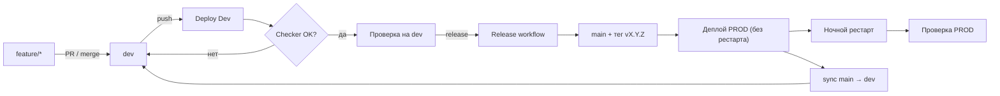
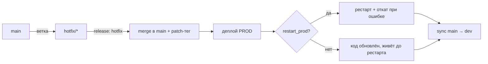

# Minequest Server Source


Репозиторий-конфигурация Minecraft-сети **Minequest**: в нём живут файлы Paper-серверов (лобби `adjustment` и основной мир `playworld`), конфигурация Velocity-прокси и вся обвязка для деплоя, запуска, перезапуска и отката стендов. Git здесь — это «источник правды»: серверы на проде работают прямо из git-чекаута, а GitHub Actions обновляют этот чекаут и перезапускают процессы. Отдельно есть dev-стенд, который автоматически собирается из ветки `dev`, и prod-стенд, который обновляется только через ручной release-пайплайн по тегам `vX.Y.Z`. Вся чувствительная информация (секреты, локальные порты и лимиты памяти) вынесена из репозитория в локальные `secrets` и `overrides`, а нештатные изменения конфигов ловит Checker.

---

## Содержание

1. [Быстрый старт](#быстрый-старт)
2. [Структура репозитория](#структура-репозитория)
3. [Как устроены стенды](#как-устроены-стенды)
4. [GitHub Actions: пайплайны](#github-actions-пайплайны)
5. [Скрипты](#скрипты)
6. [Инструменты разработчика](#инструменты-разработчика)
   - [Overrides](#overrides)
   - [.checkerignore](#checkerignore)
   - [Secrets](#secrets)
7. [Чем dev отличается от prod](#чем-dev-отличается-от-prod)
8. [Разработка фичи: пошаговый flow](#разработка-фичи-пошаговый-flow)
9. [Хотфиксы: пошаговый flow](#хотфиксы-пошаговый-flow)
10. [Операции: рестарты и откат](#операции-рестарты-и-откат)
11. [Частые проблемы](#частые-проблемы)
12. [Чеклисты](#чеклисты)

---

## Быстрый старт

Требуется: git, JDK 25 (для запуска ядер), Python 3.10+ (для скриптов overrides/secrets), на сервере — Linux, `screen`, `ss`, `flock`, `sha1sum`.

```bash
git clone git@github.com:sednith/MinequestServerSource.git
cd MinequestServerSource

# 1. Ветка разработки
git switch dev
git pull

# 2. Python-окружение для overrides (нужно только на dev-стенде и локально)
python3 -m venv .venv
.venv/bin/python -m pip install -r scripts/requirements-overrides.txt

# 3. Локальные секреты (в git не попадают)
cat > secrets <<'EOF'
ADJUSTMENT_MANAGEMENT_SECRET=...
PLAYWORLD_MANAGEMENT_SECRET=...
VELOCITY_FORWARDING_SECRET=...
EOF

# 4. Локальные overrides (в git не попадают) — см. раздел Overrides
```

> [!IMPORTANT]
> Никогда не коммитьте файл `secrets`, папку `overrides/` и результаты их применения к конфигам. Всё это уже в `.gitignore`, но перед коммитом всё равно проверяйте `git status`.

> [!NOTE]
> **Windows vs Linux.** Все скрипты и пайплайны рассчитаны на Linux-сервер (`/home/server/dev`, `/home/server/prod`, GNU Screen, `/proc`). На Windows разработчик работает только с git и Python: путь к интерпретатору venv там `.venv\Scripts\python.exe`, а bash-примеры ниже нужно запускать в WSL/Git Bash либо переписывать под PowerShell.

---

## Структура репозитория

```
.
├── .github/workflows/          # 5 пайплайнов GitHub Actions
│   ├── deploy_dev.yml
│   ├── release.yml
│   ├── restart_servers.yml
│   ├── scheduled_prod_restart.yml
│   └── start_servers.yml
├── adjustment/                 # Paper-сервер: лобби
│   ├── paper-26.3-226.jar
│   ├── server.properties
│   ├── java-args
│   ├── config/paper-global.yml
│   ├── bukkit.yml, spigot.yml, commands.yml, eula.txt
│   └── world/dimensions/minecraft/*/paper-world.yml
├── playworld/                  # Paper-сервер: основной мир
│   └── ... (та же структура)
├── velocity/                   # Velocity-прокси
│   ├── velocity-4.3.0-44.jar
│   ├── velocity.toml
│   ├── forwarding.secret       # содержит только ${VELOCITY_FORWARDING_SECRET}
│   └── java-args
├── scripts/                    # вся серверная автоматика
│   ├── common.sh               # общие функции
│   ├── start-all.sh / startserver.sh
│   ├── restart.sh / restart-server.sh
│   ├── scheduled-restart.sh
│   ├── rollback-prod.sh
│   ├── deploy-dev.sh
│   ├── checker.sh
│   ├── apply-overrides.sh / .py
│   ├── redact-diff.py
│   └── render-secrets/
│       ├── manifest.py
│       ├── render-secrets.py
│       ├── render-secrets.properties  # манифест секретных файлов
│       └── snapshot-configs.py
├── overrides/                  # локально, git-ignored
├── .checkerignore              # правила для Checker
└── .gitignore
```

**Важно про git:** в репозитории лежат jar-файлы ядер, конфиги и `paper-world.yml` для каждого мира. Сами миры, логи, `ops.json`, whitelist/banlist, `plugins/spark`, `libraries/`, `versions/` — в git не входят (см. `.gitignore`). То есть репозиторий описывает **как** запускать сервер, но не хранит игровые данные.

---

## Как устроены стенды

```
                    ┌──────────────────────────────┐
   push в dev  ───► │  DEV  /home/server/dev       │
                    │  ветка: dev                  │
                    │  overrides: ДА               │
                    │  Checker: ДА                 │
                    │  порты: 265xx                │
                    └──────────────────────────────┘
                                  │
                                  │ release workflow (вручную)
                                  │ merge dev → main + тег vX.Y.Z
                                  ▼
                    ┌──────────────────────────────┐
                    │  PROD /home/server/prod      │
                    │  ветка: main                 │
                    │  overrides: НЕТ              │
                    │  Checker: НЕТ                │
                    │  порты: 255xx                │
                    │  откат по last-good SHA      │
                    └──────────────────────────────┘

  Поток игрока внутри стенда:  Velocity (прокси) → adjustment (лобби) → playworld (основной мир)
  Процессы живут в GNU Screen:  <env>-playworld, <env>-adjustment, <env>-velocity
```

- **Ядро** определяется по имени jar: `velocity*.jar` → Velocity, всё остальное → Paper.
- **Порядок рестарта** в `restart.sh`: `playworld → adjustment → velocity` (сначала бэкенды, потом прокси, чтобы игроки не ловили «connection refused»).
- **Порядок ночного рестарта** (`scheduled-restart.sh`): `adjustment → playworld → velocity` с паузами 15 минут, чтобы новый код сначала обкатался на лобби.
- Каждый сервер пишет `.server.pid`, общается с супервизором через FIFO `server_console`, а супервизор (`startserver.sh`) автоматически поднимает процесс через 5 секунд после падения.

---

## GitHub Actions: пайплайны

Все пять пайплайнов используют одну и ту же concurrency-группу `minecraft-server-deploy` с `cancel-in-progress: false`. Это значит: **любые два деплоя/рестарта выполняются строго последовательно**, второй ждёт первый. Это защита от одновременного рестарта и раскатки.

### Требуемые GitHub Secrets

| Secret | Назначение |
|---|---|
| `REMOTE_HOST` | Хост сервера, куда идёт SSH |
| `REMOTE_USER` | Пользователь SSH |
| `REMOTE_PORT` | Порт SSH |
| `SSH_PRIVATE_KEY` | Приватный ключ для SSH |
| `RELEASE_TOKEN` | PAT с правами записи (push в `main`, `dev` и теги) — используется только в `release.yml` |

Значения секретов не выводятся в логах. Все пайплайны ходят на сервер через `appleboy/ssh-action` с `command_timeout: 20m`.

---

### 1. `deploy_dev.yml` — Deploy Dev Environment

**Что это.** Автоматический деплой dev-стенда при каждом пуше в ветку `dev`.

**Когда запускается.** `push` в `dev` (обычный коммит, merge, синк из `main` — всё равно).

**Что делает.**

1. По SSH заходит на сервер, в `/home/server/dev`.
2. Жёстко синхронизирует дерево: `git fetch origin dev`, `git checkout -f -B dev origin/dev`, `git reset --hard origin/dev`. Локальные правки на стенде затираются — это нормально, все правки должны жить в git.
3. Запускает `scripts/deploy-dev.sh`, который проходит 4 стадии:
   - **STAGE 1/4 — Sync & Overrides.** Повторная синхронизация, применение `overrides/`, создание временного коммита **B** (в него не попадают файлы из манифеста секретов), рендер `secrets`, снятие приватного baseline-снапшота секретных конфигов.
   - **STAGE 2/4 — Restart.** Последовательный рестарт `playworld → adjustment → velocity` с ожиданием строк готовности в логах.
   - **STAGE 3/4 — Checker.** Проверка, что после запуска серверы не изменили ничего неожиданного (см. [.checkerignore](#checkerignore)).
   - **STAGE 4/4 — Cleanup.** Удаление временного коммита B и baseline-снапшота; при падении Checker'а печатаются отчёты.

**Как пользоваться.** Ничего не нажимать. Влили фичу в `dev` и запушили — пайплайн поехал. Смотреть: вкладка **Actions → Deploy Dev Environment**.

**Особенности.**

- Если в этом же пуше изменился `deploy-dev.sh`, скрипт перезапускает сам себя на новой версии (`DEPLOY_DEV_REEXEC=1`) — иначе bash дочитал бы старый файл.
- Checker упал → деплой считается провалившимся, отчёты лежат в `checker-report/` на стенде (`git-status.txt`, `git-diff.txt`), значения секретов в диффе замаскированы.
- Падение деплоя **не** откатывает dev: стенд остаётся на новой версии, но с красным прогоном. Это сигнал «почини правила или конфиг».

---

### 2. `release.yml` — Release and Deploy PROD

**Что это.** Ручной релизный пайплайн: merge в `main`, создание тега версии и раскатка на PROD. Умеет два режима — обычный релиз и хотфикс.

**Когда запускается.** Только вручную: **Actions → Release and Deploy PROD → Run workflow**.

**Входные параметры.**

| Параметр | Значения | Смысл |
|---|---|---|
| `release_mode` | `release` / `hotfix` | Обычный релиз из `dev` или хотфикс из отдельной ветки |
| `release_type` | `patch` / `minor` / `major` | Насколько поднять версию (для хотфикса игнорируется, всегда `patch`) |
| `hotfix_branch` | строка | Имя ветки-источника хотфикса (для `release` игнорируется) |
| `restart_prod` | `true` / `false` | Перезапустить ли PROD сразу после деплоя (по умолчанию `false`) |

**Что делает.**

1. **Merge и тег** (job `release-and-deploy`, на раннере):
   - `release`: проверяет, что `origin/main` является предком `origin/dev`. Если в `main` есть коммиты, которых нет в `dev` (например, после неудачного хотфикса) — **релиз блокируется**. Дальше `git merge origin/dev --no-ff` в `main`.
   - `hotfix`: валидирует имя ветки, запрещает `main` и `dev` как источник, делает `git merge origin/<hotfix_branch> --no-ff`.
   - Берёт последний тег `vX.Y.Z`, доступный из `main`, и инкрементирует версию по `release_type` (для хотфикса — patch).
   - Проверяет, что такого тега ещё нет (локально и на origin), иначе аварийно выходит **до** пуша.
   - Собирает changelog из `git log LATEST_TAG..HEAD`, выбрасывая коммиты с меткой `[internal]`. Если ничего не осталось — пишет «Мелкие правки и улучшения».
   - Создаёт annotated-тег `vX.Y.Z` с changelog в сообщении и делает **атомарный** `push origin main refs/tags/vX.Y.Z`.
2. **Деплой PROD** (SSH-шаг):
   - **Этап 1/3:** `git fetch origin --tags`, `git checkout -f -B main <origin/main>`, `git reset --hard`. Код на PROD обновлён.
   - **Этап 2/3 (только если `restart_prod=true`):** проверяет файл `.last-good-deploy-sha`, запускает `restart.sh prod`. При успехе записывает новый SHA как «последний успешный». При неудаче `restart.sh` сам откатывает PROD на last-good, а job падает.
   - **Этап 3/3:** синхронизирует `main` в `dev` (`merge --no-ff`, коммит `chore: sync main into dev [internal]`, `push origin dev`), если `dev` отстаёт от `main`. Этот push триггерит `deploy_dev.yml`.
3. **Финальный лог:** `[OK] Релиз vX.Y.Z развернут на PROD`.

> [!IMPORTANT]
> Обычный релиз (`release`) **не перезапускает серверы**. Он только обновляет рабочий каталог. Новый код реально стартует либо на ночном рестарте, либо при ручном запуске `Restart Minecraft Servers`. Это сделано специально: релиз можно готовить днём, а применение — ночью.

**Как пользоваться.**

- Обычный релиз: `release_mode=release`, выберите `patch/minor/major`, `restart_prod` можно игнорировать.
- Хотфикс: `release_mode=hotfix`, `hotfix_branch=<имя ветки>`, `restart_prod=true`, если нужно поднять прямо сейчас.

**Если релиз упал.**

- Тег и `main` остаются опубликованными (тег — исторический факт).
- `dev` не синхронизируется.
- Следующий обычный релиз будет заблокирован проверкой `main ⊆ dev` → нужно влить `main` в `dev` и запушить:
  ```bash
  git switch dev && git pull
  git merge origin/main
  git push origin dev
  ```

---

### 3. `restart_servers.yml` — Restart Minecraft Servers

**Что это.** Ручной рестарт выбранного стенда без обновления кода.

**Когда запускается.** Вручную: **Actions → Restart Minecraft Servers → Run workflow**, параметр `environment` = `dev` | `prod`.

**Что делает.** Заходит в `/home/server/<env>` и запускает `bash ./scripts/restart.sh <env>`.

- Сначала подставляет `secrets` (на обоих стендах).
- На `dev` дополнительно применяет `overrides/`.
- Затем последовательно перезапускает `playworld → adjustment → velocity`, ожидая готовности каждого.
- На `prod` при падении любого сервера автоматически откатывается на `.last-good-deploy-sha` и перезапускает стенд на нём.
- На `dev` отката нет — просто останавливается и падает с ошибкой.

**Как пользоваться.** Нужно поднять новый PROD-код днём, не дожидаясь ночи → сначала `release`, потом этот пайплайн с `environment=prod`.

---

### 4. `start_servers.yml` — Start Minecraft Servers

**Что это.** Запуск ранее остановленного стенда (например, после ручной остановки или перезагрузки машины).

**Когда запускается.** Вручную: **Actions → Start Minecraft Servers → Run workflow**, `environment` = `dev` | `prod`.

**Что делает.** `bash ./scripts/start-all.sh <env>`:

- проверяет `screen` и `ss`;
- на `dev` применяет overrides, на обоих стендах рендерит секреты;
- запускает `playworld → adjustment → velocity` в Screen-сессиях `<env>-<server>`;
- **идемпотентен**: если сервер уже работает (сессия + PID + порт совпадают), он не перезапускается, а просто ждёт готовности;
- отказывается запускать второй экземпляр, если порт уже занят;
- ждёт маркер готовности в логе до 300 секунд (`Done ... For help` для Paper, `Done (Xs)!` для Velocity).

**Как пользоваться.** Только для «поднять то, что лежит». Если сервер уже работает — пайплайн завершится успешно, ничего не трогая.

---

### 5. `scheduled_prod_restart.yml` — Scheduled PROD restart

**Что это.** Ночной рестарт PROD с раскаткой уже развёрнутого кода и защитой откатом.

**Когда запускается.**

- По расписанию: `cron: '45 1 * * *'` (UTC) = **04:45 МСК**.
- Вручную: **Actions → Scheduled PROD restart → Run workflow**, `stage` = `all` | `adjustment` | `playworld` | `velocity`.

**Что делает.** Три последовательных job'а с паузой 900 секунд (15 минут):

| Время (МСК) | Job | Действие |
|---|---|---|
| 04:45 | `adjustment` | Рестарт лобби, фиксирует `target_sha` и `last_good_sha` в state-файл |
| 05:00 | `playworld` | Рестарт основного мира |
| 05:15 | `velocity` | Рестарт прокси (пропускается, если в `velocity/` между last-good и target нет изменений), затем обновляет `.last-good-deploy-sha` |

Каждый этап вызывает `scripts/scheduled-restart.sh <stage>`:

- проверяет, что PROD не изменился между этапами (HEAD и last-good SHA совпадают) — иначе стоп без отката чужого обновления;
- не даёт выполнить один и тот же этап дважды за день;
- при падении любого этапа откатывает PROD на last-good через `rollback-prod.sh` и помечает день как неуспешный;
- пишет прогресс в `.scheduled-prod-restart-state` (git-ignored).

**Как пользоваться.** Обычно — не трогать, работает само. Вручную полезно, чтобы прогнать один этап (`stage=velocity`) или повторить ночной цикл днём (`stage=all`).

> [!WARNING]
> Этап `playworld` не запустится, если лобби не прошло проверку; `velocity` — если не прошли оба предыдущих. Это осознанная деградация «лучше не поднимать дальше, чем поднять всё сломанным».

---

## Скрипты

Все скрипты лежат в `scripts/` и запускаются **на сервере**, из корня чекаута. Ручной запуск — только по необходимости, в обычной работе их вызывают пайплайны.

| Скрипт | Что делает | Кто вызывает |
|---|---|---|
| `common.sh` | Библиотека: пути, лог, поиск серверных папок, определение ядра, проверка PID. Не запускается сама. | все остальные |
| `start-all.sh <dev\|prod>` | Запуск всех серверов по порядку с ожиданием готовности. Идемпотентен. | `start_servers.yml` |
| `startserver.sh <server>` | Супервизор одного сервера: FIFO, PID-файл, автоперезапуск через 5 с, корректная остановка по `stop`/`shutdown`. | `start-all.sh` |
| `restart.sh <dev\|prod> [--no-rollback]` | Рендер секретов (+ overrides на dev), затем рестарт всех серверов. На prod умеет откат. Защищён от параллельного запуска через `flock`. | `restart_servers.yml`, `deploy-dev.sh`, `rollback-prod.sh` |
| `restart-server.sh <server>` | Рестарт одного сервера: команда в FIFO → ожидание остановки (30 с) → ожидание нового PID → ожидание маркера готовности (120 с). | `restart.sh`, `scheduled-restart.sh` |
| `scheduled-restart.sh <stage>` | Один этап ночного рестарта: state-файл, защита от повторного запуска, откат при ошибке, обновление last-good SHA. | `scheduled_prod_restart.yml` |
| `rollback-prod.sh` | Откат PROD на SHA из `.last-good-deploy-sha`, рендер секретов, рестарт. Копирует скрипты в `.rollback-scripts.<pid>`, чтобы пережить checkout старого дерева. | `restart.sh`, `scheduled-restart.sh` |
| `deploy-dev.sh` | Полный dev-деплой: sync → overrides → commit B → secrets → baseline → рестарт → Checker → cleanup. | `deploy_dev.yml` |
| `checker.sh` | Сравнивает состояние после запуска с зафиксированным baseline, применяет `.checkerignore`, пишет отчёты. | `deploy-dev.sh` |
| `apply-overrides.sh` | Обёртка: запускает `apply-overrides.py` из `.venv`. | `deploy-dev.sh`, `restart.sh`, `start-all.sh` |
| `apply-overrides.py` | Точечное применение `overrides/` к YAML/TOML/JSON/properties/`java-args` с сохранением форматирования. | `apply-overrides.sh` |
| `render-secrets/render-secrets.py` | Подставляет `${NAME}` из локального `secrets` в файлы из манифеста. | `start-all.sh`, `restart.sh`, `rollback-prod.sh`, `scheduled-restart.sh`, `deploy-dev.sh` |
| `render-secrets/snapshot-configs.py` | Снимает приватный baseline секретных конфигов для Checker'а. | `deploy-dev.sh` |
| `render-secrets/manifest.py` | Парсер манифеста секретов. | `render-secrets.py`, `snapshot-configs.py`, `redact-diff.py` |
| `redact-diff.py` | Маскирует значения секретов в отчётах Checker'а. | `checker.sh` |

> [!TIP]
> Если добавляете новую серверную папку (ещё одно ядро), её нужно прописать в **трёх** списках порядка: `SERVER_START_ORDER` в `deploy-dev.sh`, `SERVER_RESTART_ORDER` в `restart.sh`, `SERVER_START_ORDER` в `start-all.sh`. `deploy-dev.sh` специально падает, если находит серверную папку, которой нет в списке.

---

## Инструменты разработчика

### Overrides

**Зачем.** Prod и dev должны отличаться (порты, лимиты памяти), но хранить две копии конфигов — боль. Поэтому в репозитории лежат **продакшн-значения**, а dev-значения накладываются сверху локальными файлами в `overrides/`.

**Как это работает.** `scripts/apply-overrides.py` берёт каждый файл из `overrides/`, находит такой же путь от корня репозитория и **частично** его правит:

| Тип файла | Поведение |
|---|---|
| `.yml` / `.yaml` | Рекурсивный merge; остальные ключи и форматирование сохраняются |
| `.toml` | Рекурсивный merge через `tomlkit`; форматирование сохраняется |
| `.json` | Меняются только указанные ключи; **отсутствующий ключ — ошибка** |
| `.properties` | Меняются значения указанных ключей; ключ должен встречаться **ровно один раз** |
| `java-args` | Разрешена ровно одна строка `-Xmx<size>`; заменяется только `-Xmx` |

**Правила.**

- Override применяется, только если путь принадлежит **ровно одной** серверной папке (папка с `java-args` и jar-файлом). Иначе — warning и пропуск.
- Если базового файла нет — warning и пропуск.
- Папка `overrides/` в `.gitignore`, у каждого разработчика и на каждом стенде она своя.
- Overrides применяются **только на dev** (`restart.sh` явно пишет, что на prod они игнорируются).

**Пример.** Так выглядит `overrides/` на dev-стенде (в git эта папка не попадает):

```text
overrides/
├── adjustment/
│   ├── server.properties     # server-port: 26511
│   └── java-args             # -Xmx512M
├── playworld/
│   ├── server.properties     # server-port: 26522
│   └── java-args             # -Xmx1G
└── velocity/
    ├── velocity.toml         # bind = "0.0.0.0:26565" + [servers] на 26511/26522
    └── java-args             # -Xmx512M
```

`overrides/adjustment/server.properties`:

```properties
server-port: 26511
```

`overrides/playworld/java-args`:

```text
-Xmx1G
```

`overrides/velocity/velocity.toml`:

```toml
bind = "0.0.0.0:26565"

[servers]
adjustment = "127.0.0.1:26511"
playworld = "127.0.0.1:26522"
```

**Как проверить локально.**

```bash
.venv/bin/python scripts/apply-overrides.py
# [INFO] Обработка adjustment: adjustment/server.properties
#        [OK] Override применён; остальные строки сохранены
# [INFO] Итого: применено=6, пропущено=0, ошибок=0
```

> [!WARNING]
> Не коммитьте результат применения overrides. `git status` покажет изменённые `server.properties` и `java-args` — это нормально для dev-стенда, но в репозиторий это попадать не должно. Следующий dev-деплой сам сделает `git reset --hard origin/dev` и наложит overrides заново.

**Когда нужен `overrides/`, а когда — правка конфига в git:**

| Ситуация | Куда писать |
|---|---|
| Значение должно быть одинаковым на dev и prod | В сам конфиг, коммит в `dev` |
| Значение только для dev (порты, память, MOTD) | В `overrides/` |
| Секрет, пароль, ключ | В `secrets` + плейсхолдер в конфиге |

---

### .checkerignore

**Зачем.** После запуска Paper/Velocity переписывают конфиги: меняют пробелы, добавляют свой заголовок с датой, подставляют реальные секреты вместо них. Checker сравнивает состояние «сразу после старта» и «до старта» и падает, если видит любое изменение. `.checkerignore` — whitelist легитимных изменений.

**Как это работает.** Checker запускается только на dev, в конце `deploy-dev.sh`. Он:

1. Сравнивает рабочее дерево с временным коммитом B (в B не входят секретные файлы).
2. Для секретных файлов сравнивает с приватным baseline-снапшотом (снятым после рендера секретов).
3. Для `.properties` — сравнивает семантические пары ключ/значение (без учёта комментариев, пробелов и `\:`).
4. Для `.yml`/`.yaml`/`.json` — сравнивает только добавленные строки.
5. Всё, что не покрыто правилами, считается неизвестным изменением → деплой падает, а в `checker-report/git-status.txt` и `checker-report/git-diff.txt` появляются отчёты (значения секретов маскируются `<REDACTED>`).

**Синтаксис.** Один файл — одно правило на строку. Пустые строки и `#`-комментарии игнорируются. Пути — от корня репозитория.

| Формат строки | Тип | Что делает |
|---|---|---|
| `path/или/файл` | GLOB | Игнорирует файл/папку целиком. Поддерживает `*` и префикс папки (`overrides/` игнорирует всё внутри) |
| `path/file.properties:ключ` | KEY | Разрешает изменение конкретного ключа в `.properties` |
| `path/file.yml:#регулярка` | REGEX | Разрешает строки, подходящие под регулярное выражение (RE2/grep -E). Работает для `.properties`, `.yml`, `.yaml`, `.json` |

**Текущее содержимое:**

```gitignore
# Регулярка для строк-комментариев с годом (сгенерированный заголовок properties)
playworld/server.properties:#.*[0-9]{4}
adjustment/server.properties:#.*[0-9]{4}

# Локальная папка overrides и сами правила Checker'а
overrides/
.checkerignore
scripts/checker.sh

# Paper перезаписывает секрет управления — разрешаем это конкретное поле
playworld/server.properties:management-server-secret
adjustment/server.properties:management-server-secret

# Секрет Velocity в paper-global.yml — разрешаем любые изменения этой строки
playworld/config/paper-global.yml:#^[[:space:]]*secret:.*$
adjustment/config/paper-global.yml:#^[[:space:]]*secret:.*$
```

**Примеры добавления правил.**

Dev-деплой упал с `Неизвестное изменение ключа: motd`:

```text
playworld/server.properties:motd
```

Плагин дописывает блок в YAML с рандомным ID:

```text
playworld/config/paper-global.yml:#^[[:space:]]*instance-id:.*$
```

Появился новый рантайм-файл, который нельзя класть в git:

```text
playworld/plugins/MyPlugin/cache/
```

> [!IMPORTANT]
> Правило — это не «заглушить ошибку». Если сервер изменил важный ключ, это может быть баг или неверный конфиг: сначала разберитесь, потом добавляйте исключение. `scripts/checker.sh` и `.checkerignore` сами исключены из проверки, чтобы правка правил не ломала деплой.

---

### Secrets

**Зачем.** Пароли, ключи и токены не должны попадать в git, но должны быть в конфигах на сервере. Решение: в репозитории лежат **плейсхолдеры** `${NAME}`, а реальные значения — в локальном файле `secrets`, который рендерится перед каждым запуском.

**Файл `secrets`** (корень репозитория, в `.gitignore`, не коммитится):

```text
# Комментарии начинаются с #
ADJUSTMENT_MANAGEMENT_SECRET=super-secret-1
PLAYWORLD_MANAGEMENT_SECRET=super-secret-2
VELOCITY_FORWARDING_SECRET=super-secret-3
```

Правила формата: `KEY=VALUE`, по одной паре на строку, `KEY` — `[A-Za-z_][A-Za-z0-9_]*`, значение — всё после первого `=`. Дубликаты и битые строки — ошибка. Файл должен существовать на **каждом** стенде (dev и prod), пайплайн его не передаёт.

**Манифест** `scripts/render-secrets/render-secrets.properties` — список файлов, в которых вообще разрешено рендерить плейсхолдеры:

```properties
# путь_от_корня=формат
adjustment/config/paper-global.yml=yaml
adjustment/server.properties=properties
playworld/config/paper-global.yml=yaml
playworld/server.properties=properties
velocity/forwarding.secret=raw
```

Поддерживаемые форматы: `yaml`, `toml`, `json`, `properties`, `raw`.

| Формат | Как подставляется значение |
|---|---|
| `yaml` / `toml` / `json` | JSON-экранирование, плейсхолдер должен быть **внутри кавычек** |
| `properties` | экранируются `\ : = # !`, переводы строк → `\u000a` и т.п. |
| `raw` | как есть, без экранирования (для файлов вида `forwarding.secret`) |

**Примеры в конфигах.**

`playworld/config/paper-global.yml`:

```yaml
proxies:
  velocity:
    enabled: true
    online-mode: true
    secret: "${VELOCITY_FORWARDING_SECRET}"
```

`playworld/server.properties`:

```properties
management-server-secret=${PLAYWORLD_MANAGEMENT_SECRET}
```

`velocity/forwarding.secret` (файл целиком):

```text
${VELOCITY_FORWARDING_SECRET}
```

**Как добавить новый секрет.**

1. Поставьте плейсхолдер в конфиг: `${MY_NEW_TOKEN}` (в YAML — обязательно в кавычках).
2. Убедитесь, что путь к этому файлу есть в `render-secrets.properties` (если файла там нет — добавьте строку с форматом).
3. Добавьте `MY_NEW_TOKEN=...` в `secrets` **на dev и на prod**.
4. Задеплойте. Рендер происходит автоматически перед стартом/рестартом.

**Когда рендерятся секреты.** `start-all.sh`, `restart.sh`, `rollback-prod.sh`, `scheduled-restart.sh`, `deploy-dev.sh`. Всегда **до** остановки серверов: если секрет отсутствует или плейсхолдер битый — стенд не будет тронут, скрипт упадёт заранее.

**Защита от утечек.**

- Секретные файлы исключаются из временного коммита B (иначе реальные значения попали бы в git-объекты).
- Отчёты Checker'а проходят через `redact-diff.py`: поля с `secret`/`password`/`token`/`api_key` маскируются, а для `raw`-файлов скрывается всё содержимое.
- Логи рендера печатают только имена файлов и «значения не выводятся».

---

## Чем dev отличается от prod

| | **DEV** | **PROD (main)** |
|---|---|---|
| Каталог | `/home/server/dev` | `/home/server/prod` |
| Ветка | `dev` | `main` (чекаут на коммит из `origin/main`) |
| Как обновляется | Автоматически: push в `dev` → `deploy_dev.yml` | Вручную: `release.yml` (merge + тег) |
| Версионирование | Нет тегов | Теги `vX.Y.Z`, changelog в аннотации тега |
| Когда реально стартует новый код | Сразу, деплой сам делает рестарт | На ночном рестарте (04:45/05:00/05:15 МСК) или вручную через `Restart Minecraft Servers` |
| Overrides (`overrides/`) | **Применяются** | **Не применяются** |
| Checker | **Работает**, падение = красный деплой | Не запускается |
| Порты | 26511 / 26522 / 26565 | 25511 / 25522 / 25565 |
| Память (`-Xmx`) | 512M / 1G / 512M | 2048M / 8192M / 2048M |
| MOTD | Наследуется из базовых конфигов (легко переопределить в overrides) | `Minequest ... Prod Server` |
| Откат при неудачном рестарте | Нет | Есть: `.last-good-deploy-sha` + `rollback-prod.sh` |
| GitHub Secrets | `REMOTE_*`, `SSH_PRIVATE_KEY` | те же + `RELEASE_TOKEN` |

Логика простая: **dev — быстрый и «грязный»**, там можно ломать и перезапускать сколько угодно, а **prod — медленный и защищённый**, там каждое изменение проходит через тег, ночной рестарт и точку отката.

---

## Разработка фичи: пошаговый flow



### Шаг 1. Синхронизировать `dev`

```bash
git switch dev
git pull origin dev
```

Никогда не начинайте фичу со старого `dev` — потом будет больно мержить.

### Шаг 2. Создать ветку

```bash
git switch -c feature/<короткое-имя>
# например: feature/new-lobby-spawn, feature/update-velocity
```

Соглашение по именам: `feature/*`, `fix/*`, `hotfix/*`, `chore/*`. Ветка создаётся **от `dev`**, не от `main`.

### Шаг 3. Внести изменения

Что обычно меняется:

- конфиги серверов (`server.properties`, `paper-global.yml`, `spigot.yml`, `bukkit.yml`, `commands.yml`);
- `paper-world.yml` конкретного мира;
- `java-args` (только если меняете флаги JVM);
- `velocity.toml`;
- версия ядра (замена jar-файла);
- скрипты и пайплайны.

Правила:

- **Не коммитьте** `secrets`, `overrides/`, `checker-report/`, логи, `.server.pid`, миры, `ops.json`, whitelist/banlist.
- Если значение нужно только dev — используйте `overrides/`, а не коммит.
- Если нужен секрет — плейсхолдер `${NAME}` + запись в манифесте.
- Коммиты, которые не должны попасть в changelog релиза, помечайте `[internal]` в заголовке.

```bash
git add playworld/config/paper-global.yml
git commit -m "feat: increase view distance in playworld"
```

### Шаг 4. Проверить локально (что возможно)

Полный запуск серверов рассчитан на Linux (`screen`, `ss`, `/proc`), поэтому на Windows проверяйте только то, что не требует запуска:

```bash
# Python-скрипты (Linux / Git Bash / WSL; на Windows-native venv — .venv\Scripts\python.exe)
.venv/bin/python scripts/apply-overrides.py     # overrides применяются без ошибок
python3 -c "import sys; sys.path.insert(0,'scripts/render-secrets'); from manifest import load_manifest; print(load_manifest())"

# YAML/TOML-валидность
python3 -c "import yaml,sys; yaml.safe_load(open('playworld/config/paper-global.yml'))"

# Синтаксис shell-скриптов
bash -n scripts/deploy-dev.sh scripts/restart.sh scripts/checker.sh
```

### Шаг 5. Запушить ветку

```bash
git push -u origin feature/<короткое-имя>
```

Дальше — PR в `dev`. Ревью смотрит на: конфиги, отсутствие секретов, отсутствие локальных dev-значений, влияние на TPS/память (для `-Xmx` и GC-флагов).

### Шаг 6. Влить в `dev`

Через PR (кнопка **Merge pull request**) или локально:

```bash
git switch dev
git pull origin dev
git merge --no-ff feature/<короткое-имя>
git push origin dev
```

`--no-ff` сохраняет историю фичи отдельной ветвью — так проще откатывать и читать changelog. Push в `dev` **автоматически** запускает `Deploy Dev Environment`.

### Шаг 7. Дождаться зелёного деплоя

**Actions → Deploy Dev Environment**. Прогон занимает несколько минут (рестарт трёх серверов с ожиданием готовности).

Если упало на Checker'е:

1. Откройте лог job'а — там будет `git-status.txt` и `git-diff.txt`.
2. Поймите, что именно сервер изменил.
3. Если изменение легитимное — добавьте правило в `.checkerignore` **в новую ветку** и повторите шаги 5–6.
4. Если изменение неожиданное — чините конфиг/плагин, а не правило.

Если упало на рестарте: смотрите `logs/latest.log` проблемного сервера; dev отката не имеет, стенд останется на новой версии.

### Шаг 8. Проверить на dev-стенде

Подключитесь на dev-порты (`26565` — прокси) и проверьте именно то, что меняли: вход, переход между мирами, поведение плагинов, отсутствие ошибок в консоли. Не переходите к релизу, пока фича не проверена руками.

### Шаг 9. Запустить релиз

**Actions → Release and Deploy PROD → Run workflow**:

- `release_mode` = `release`;
- `release_type` = `patch` (правки/фиксы), `minor` (новая функциональность), `major` (несовместимые изменения);
- `restart_prod` = оставить `false`, если не нужно поднимать прямо сейчас;
- `hotfix_branch` — пусто.

Пайплайн сам смержит `dev` → `main`, поставит тег `vX.Y.Z` и обновит код на PROD.

> [!NOTE]
> Если релиз заблокирован сообщением «В origin/main есть коммиты, отсутствующие в origin/dev» — значит, до этого был неудачный хотфикс. Выполните `git switch dev && git pull && git merge origin/main && git push origin dev` и запустите релиз снова.

### Шаг 10. Выкатить в прод (рестарт)

Обычный релиз **не перезапускает** серверы. Варианты:

- **Ночью автоматически** — `Scheduled PROD restart` в 04:45 МСК: лобби в 04:45, основной мир в 05:00, прокси в 05:15.
- **Днём вручную** — **Actions → Restart Minecraft Servers**, `environment=prod`. При неудаче PROD сам откатится на последнюю успешную версию.

### Шаг 11. Проверить PROD

- Job `Scheduled/Manual restart` зелёный.
- `.last-good-deploy-sha` на PROD обновился на новый SHA (это делает успешный ночной цикл или релиз/хотфикс с `restart_prod=true`).
- В игре всё работает на боевых портах.

### Шаг 12. Убрать ветку (опционально)

```bash
git branch -d feature/<короткое-имя>
git push origin --delete feature/<короткое-имя>
```

> [!TIP]
> После релиза `release.yml` сам синхронизирует `main` в `dev` коммитом `chore: sync main into dev [internal]`. Этот коммит не попадёт в changelog следующего релиза благодаря метке `[internal]`.

---

## Хотфиксы: пошаговый flow

Хотфикс — когда прод сломан и ждать ночного релиза нельзя. Ключевое отличие: ветка создаётся **от `main`**, а не от `dev`, чтобы не тащить в прод незавершённые фичи.



### Шаг 1. Создать ветку от `main`

```bash
git fetch origin
git switch -c hotfix/<короткое-имя> origin/main
```

Имя должно быть отдельной веткой — `main` и `dev` пайплайн отклонит.

### Шаг 2. Исправить и проверить

Минимальный, точечный диф. Не рефакторите, не обновляйте зависимости «заодно» — хотфикс должен быть максимально скучным.

```bash
git add <файлы>
git commit -m "fix: correct playworld spawn radius"
git push -u origin hotfix/<короткое-имя>
```

Проверка — та же, что в фиче: `bash -n`, YAML/TOML-валидность, отсутствие секретов в диффе. Прогнать хотфикс на dev нельзя: ветка от `main` может конфликтовать с `dev`.

### Шаг 3. Запустить release в режиме hotfix

**Actions → Release and Deploy PROD → Run workflow**:

| Параметр | Значение |
|---|---|
| `release_mode` | `hotfix` |
| `release_type` | любое (игнорируется, всегда `patch`) |
| `hotfix_branch` | `hotfix/<короткое-имя>` |
| `restart_prod` | `true`, если нужно поднять немедленно; `false`, если готовы ждать ближайшего рестарта |

Пайплайн: мержит ветку в `main` через `--no-ff`, ставит следующий patch-тег, атомарно пушит `main` + тег, обновляет PROD, при `restart_prod=true` перезапускает стенд с откатом.

> [!IMPORTANT]
> Для `restart_prod=true` на PROD должен существовать файл `.last-good-deploy-sha` с валидным SHA работающей версии. Если его нет, пайплайн упадёт **до** рестарта с явной ошибкой. Первый раз файл создаёт успешный ночной рестарт; при ручном вводе стенда в эксплуатацию его нужно заполнить подтверждённым SHA вручную.

### Шаг 4. Если хотфикс упал на рестарте

Что происходит:

1. `restart.sh` откатывает PROD на last-good SHA и перезапускает стенд на нём.
2. Job падает.
3. `main` и тег **остаются** опубликованными.
4. `dev` **не** синхронизируется.

Что делать:

```bash
git switch dev && git pull origin dev
git merge origin/main          # забираем изменения хотфикса
# разрешить конфликты, если есть
git push origin dev
```

Без этого шага следующий обычный релиз будет заблокирован проверкой «`main` должен быть предком `dev`».

### Шаг 5. Проверить и синхронизировать

- Убедитесь, что PROD на нужной версии (`git -C /home/server/prod rev-parse HEAD`).
- После успешного хотфикса `release.yml` сам вливает `main` в `dev` (этап 3/3) и триггерит dev-деплой.
- Удалите ветку хотфикса.

> [!WARNING]
> Не делайте хотфикс из `dev` и не пушьте в `main` напрямую. Прямой push в `main` обходит проверку `main ⊆ dev`, и следующий обычный релиз может «потерять» коммиты или заблокироваться.

---

## Операции: рестарты и откат

### Точка отката

Файл `/home/server/prod/.last-good-deploy-sha` (git-ignored) содержит SHA последней **подтверждённой** версии. Обновляется только при успешном:

- ночном этапе `velocity` (`scheduled-restart.sh`) — то есть в конце полного ночного цикла;
- `restart.sh prod`, который `release.yml` запускает при `restart_prod=true`.

> [!NOTE]
> Ручной рестарт через `Restart Minecraft Servers` **не** обновляет `.last-good-deploy-sha`: он только перезапускает стенд и при неудаче откатывается на уже подтверждённую версию. Подтверждение новой версии происходит либо ночным циклом, либо релизом/хотфиксом с `restart_prod=true`.

### Ручной откат

```bash
bash ./scripts/rollback-prod.sh
```

Скрипт: проверит SHA → скопирует текущие скрипты в `.rollback-scripts.<pid>` (чтобы пережить checkout старого дерева, где этих скриптов могло не быть) → `checkout -f -B main <sha>` + `reset --hard` → рендер секретов → `restart.sh prod --no-rollback` с проверкой готовности.

> [!CAUTION]
> Если откатный рестарт тоже не прошёл проверку, повторный откат **не** выполняется — нужен ручной разбор. Это осознанно: автоматический цикл откатов опаснее остановки.

### Откат отдельного сервера

```bash
bash ./scripts/restart-server.sh adjustment
```

Перезапускает только один сервер с проверкой PID и маркера готовности. Не меняет код.

### Параллельные рестарты

`restart.sh` берёт `flock` на файл в `$TMPDIR` (вне рабочего дерева, чтобы `git status` оставался чистым). Второй одновременный рестарт того же стенда сразу упадёт с `Рестарт ... уже выполняется другим процессом`.

---

## Частые проблемы

| Симптом | Причина | Решение |
|---|---|---|
| `[ERROR] Неизвестное изменение ключа` в dev-деплое | Paper переписал конфиг | Разобраться и добавить правило в `.checkerignore` (KEY/REGEX) или починить конфиг |
| `[ERROR] Checker завершился с ошибкой` и пустые отчёты | Baseline не создан / скрипт упал раньше | Смотреть лог стадии 3 целиком, проверить `render-secrets.properties` |
| `Не найден Python с зависимостями overrides` | Нет `.venv` | `python3 -m venv .venv && .venv/bin/python -m pip install -r scripts/requirements-overrides.txt` |
| `манифест не содержит путей конфигураций` | Пустой/битый `render-secrets.properties` | Проверить строки `путь=формат`, дубликаты и `..` |
| `переменная X отсутствует в secrets` | Секрет не добавлен на стенде | Добавить в `secrets` на этом хосте |
| `Слияние dev в main` заблокировано | В `main` есть коммиты, которых нет в `dev` | `git switch dev && git merge origin/main && git push origin dev` |
| `Тег vX.Y.Z уже существует` | Коллизия версии (в т.ч. тег с непролитой ветки) | Осознанно выбрать другой `release_type`/разобраться с тегом |
| Хотфикс упал, PROD откатился | Новая версия не прошла проверку готовности | Смотреть логи, чинить причину, повторить хотфикс; не забыть синк `main → dev` |
| `Откат недоступен: .last-good-deploy-sha отсутствует` | Нет точки отката | Дождаться успешного ночного рестарта или вручную записать подтверждённый SHA |
| `PID не соответствует запущенному ядру` | Устаревший `.server.pid` или чужой процесс на порту | Проверить `ss -ltnp`, убрать stale PID, запустить через `start-all.sh` |
| Сервер не поднялся, лог пуст | Процесс упал до записи лога | `tail -n 50 <server>/logs/latest.log`, проверить `java-args` и версию Java |
| Деплой dev «завис» | Идёт другой прогон в группе `minecraft-server-deploy` | Это ожидание очереди, не ошибка |

---

## Чеклисты

### Перед PR в `dev`

- [ ] Ветка создана от свежего `dev`
- [ ] Нет `secrets`, `overrides/`, `checker-report/`, логов и миров в диффе
- [ ] Dev-значения (порты 265xx, маленький `-Xmx`) **не** попали в конфиги — они в `overrides/`
- [ ] Секреты оформлены плейсхолдерами, путь добавлен в `render-secrets.properties`
- [ ] `bash -n` по изменённым скриптам проходит
- [ ] YAML/TOML/JSON валидны
- [ ] Мелкие служебные коммиты помечены `[internal]`, если не нужны в changelog
- [ ] Изменения `java-args` обоснованы (память/GC)

### Перед релизом

- [ ] `Deploy Dev Environment` зелёный
- [ ] Фича проверена руками на dev-стенде
- [ ] `main` является предком `dev` (иначе сначала синк)
- [ ] Выбран корректный `release_type`
- [ ] Решено, нужен ли немедленный рестарт (`restart_prod`) или ждём ночи
- [ ] Есть план проверки после рестарта

### Перед хотфиксом

- [ ] Ветка создана от `origin/main`, не от `dev`
- [ ] Диф минимальный, без рефакторинга
- [ ] Причина инцидента понятна, фикс её устраняет
- [ ] `.last-good-deploy-sha` на PROD существует и валиден (если `restart_prod=true`)
- [ ] После успеха/неудачи выполнен синк `main → dev`
- [ ] Ветка хотфикса удалена

---

<div align="center">

**Minequest** · Paper 26.3 · Velocity 4.3 · Java 25

`dev` → фичи → релиз по тегам → ночной рестарт → прод

</div>
